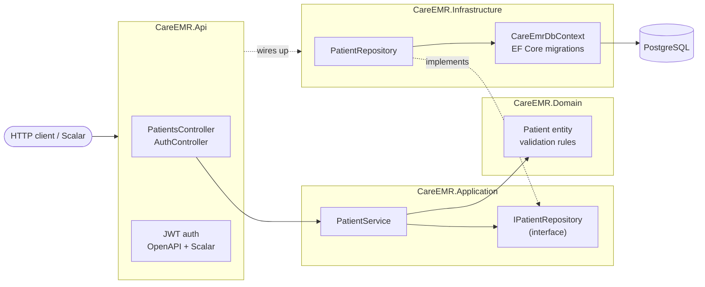

# CareEMR – Patient Registry API

[](https://github.com/Vishwas0810/CareEMR/actions/workflows/ci.yml)

A patient registry REST API for a primary care EMR, built with **.NET 10**, **ASP.NET Core**,
**EF Core** and **PostgreSQL** using clean architecture. It registers patients, validates
Ontario-style health card numbers, and protects every patient endpoint with JWT authentication.

> **Portfolio project inspired by Ontario EMR concepts; not a certified EMR; no real patient data.**

## Features

- **Patient CRUD** – create, list, get, update (`PUT`) and soft delete (`DELETE`) patients.
- **Domain validation** – required names, no future dates of birth, Ontario health card format
  (10 digits, dashes/spaces stripped, 1–2 letter version code, uppercased).
- **Duplicate protection** – a health card number can belong to only one patient (`409 Conflict`).
- **Soft delete** – deleted patients keep their record (`IsActive = false`) and are hidden by an
  EF Core global query filter.
- **Consistent errors** – RFC 9457 ProblemDetails responses for `400`, `404`, `409` and failed logins (`401`).
- **JWT authentication** – `POST /api/auth/login` issues a signed token; all `/api/patients`
  endpoints require `[Authorize]`. *(Demo only: a single configured demo user.)*
- **Interactive API docs** – OpenAPI document + [Scalar](https://scalar.com) UI with Bearer token support.
- **Tests** – 54 xUnit tests for the domain model and the application service (using a fake repository).
- **Docker** – one command runs the API and PostgreSQL 18; migrations apply automatically in Development.
- **CI** – GitHub Actions builds, tests, and smoke-tests the Docker setup on every push and PR.

## Tech stack

| Area | Technology |
|---|---|
| Runtime | .NET 10 (SDK pinned in `global.json`) |
| API | ASP.NET Core Web API (controllers), built-in OpenAPI, Scalar UI |
| Data | EF Core 10, Npgsql, PostgreSQL 18 |
| Auth | JWT bearer (`Microsoft.AspNetCore.Authentication.JwtBearer`) |
| Tests | xUnit |
| DevOps | Docker, Docker Compose, GitHub Actions |

## Architecture

Clean architecture: dependencies point inward, so the domain has no dependency on the web or the database.



| Project | Responsibility |
|---|---|
| `CareEMR.Domain` | `Patient` entity and its business rules. No dependencies. |
| `CareEMR.Application` | Use cases (`PatientService`), request/response contracts, repository interface. |
| `CareEMR.Infrastructure` | EF Core `DbContext`, migrations, repository implementation. |
| `CareEMR.Api` | Controllers, JWT auth, OpenAPI/Scalar, dependency injection setup. |
| `tests/*` | xUnit tests for Domain and Application. |

## Run with Docker (one command)

Requires [Docker Desktop](https://www.docker.com/products/docker-desktop/).

```bash
cp .env.example .env      # one-time: then replace every value in .env
docker compose up --build
```

Open **http://localhost:8080/scalar**. The API container waits for PostgreSQL to be healthy and
applies the EF Core migrations on startup. Log in with the `DEMO_USERNAME` / `DEMO_PASSWORD` you
put in `.env`. Stop with `Ctrl+C`; `docker compose down -v` also deletes the database volume.

`.env` is gitignored; `.env.example` lists every variable.

## Run locally (without Docker)

Requires the .NET 10 SDK and a PostgreSQL server.

```bash
# Secrets live in User Secrets, outside the repo
dotnet user-secrets set "ConnectionStrings:CareEmr" "Host=localhost;Database=careemr;Username=postgres;Password=<your password>" --project src/CareEMR.Api
dotnet user-secrets set "Jwt:SigningKey" "<random string, at least 32 characters>" --project src/CareEMR.Api
dotnet user-secrets set "DemoUser:Username" "demo" --project src/CareEMR.Api
dotnet user-secrets set "DemoUser:Password" "<choose a password>" --project src/CareEMR.Api

dotnet run --project src/CareEMR.Api --launch-profile http
```

Open **http://localhost:5082/scalar**. In Development, migrations are applied on startup.

Run the tests:

```bash
dotnet test
```

## Example requests

Ports: `8080` with Docker, `5082` locally. All data below is fake.
`src/CareEMR.Api/CareEMR.Api.http` has the full set for Visual Studio / VS Code.

```bash
# 1. Log in (demo user) and keep the token
TOKEN=$(curl -s -X POST http://localhost:8080/api/auth/login \
  -H "Content-Type: application/json" \
  -d '{"username":"demo","password":"<your demo password>"}' | jq -r .accessToken)

# 2. Create a patient -> 201 Created
curl -s -X POST http://localhost:8080/api/patients \
  -H "Authorization: Bearer $TOKEN" -H "Content-Type: application/json" \
  -d '{"firstName":"Test","lastName":"Patient","dateOfBirth":"1985-04-12",
       "healthCardNumber":"1234-567-890","healthCardVersionCode":"ab",
       "phone":"555-0100","email":"test.patient@example.com"}'
```

```json
{
  "id": "b3ae92bb-adb0-43c6-8a9a-70c293d8c227",
  "firstName": "Test",
  "lastName": "Patient",
  "dateOfBirth": "1985-04-12",
  "healthCardNumber": "1234567890",
  "healthCardVersionCode": "AB",
  "phone": "555-0100",
  "email": "test.patient@example.com"
}
```

| Request | Result |
|---|---|
| `GET /api/patients` | `200` list of active patients |
| `GET /api/patients/{id}` | `200`, or `404` if missing or deleted |
| `PUT /api/patients/{id}` | `200`, `400` invalid data, `404`, `409` duplicate health card |
| `DELETE /api/patients/{id}` | `204` soft delete, or `404` |
| Any `/api/patients` call without a token | `401` |

Example error (`400`, ProblemDetails):

```json
{
  "type": "https://tools.ietf.org/html/rfc9110#section-15.5.1",
  "title": "Bad Request",
  "status": 400,
  "detail": "Ontario health card number must be 10 digits."
}
```

## Security notes

- No secrets in the repository: User Secrets locally, a gitignored `.env` for Docker.
- The single demo login is **for demonstration only**. A real system would use an identity
  provider or a user store with hashed passwords, plus role-based access and audit logging.
- Scalar docs and automatic migrations are enabled in Development only.

## Possible next steps

Patient search, Ontario health card check-digit validation, role-based authorization,
audit trail of record access, and integration tests against PostgreSQL (Testcontainers).
